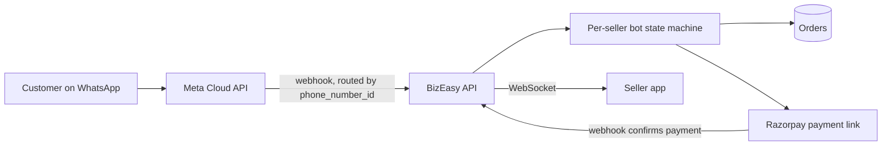

## Selected work

**[NoDues](https://www.nodues-arcclub.tech/)**  
Semester clearance for about 2,100 students and 30+ faculty at MITS. Approvals update live over server-sent events, class setup imports Excel timetables and matches faculty names fuzzily, and sessions use httpOnly cookies. React, Express, MongoDB. [Source](https://github.com/Usman0226/NoDues).

**[D'FESTA 2K26](https://dfesta.in)**  
The department symposium platform: ticketing, payments and a multi-tenant judging system. QR tickets are AES-signed, email fails over across three SMTP nodes, and UPI payments are reconciled by paise offset. Next.js, TypeScript, MongoDB.

**BizEasy**  
A seller platform for small businesses in Andhra Pradesh, run over WhatsApp, where I'm the backend engineer. Each seller connects their own WhatsApp number to their own bot, and notifications go out in Telugu and English. Node.js, Meta Cloud API, Razorpay, WebSockets.

**[NCC Exam Portal](https://ncc-exam-portal.vercel.app/)**  
Timed exams for the NCC Tirupati Unit with admin, officer and cadet roles. Tenant isolation is enforced in Prisma middleware, and the server decides when an exam ends, never the client clock. React, Express, PostgreSQL.

## Research and open source

**ConformalGuard.** A non-conformity scorer that measures how uncertain an LLM is, built on conformal prediction. In progress at MITS under faculty guidance, aimed at COPA 2027.

**[OCR_BENCHMARKING](https://github.com/Usman0226/OCR_BENCHMARKING).** Benchmarking OCR engines (PaddleOCR, Tesseract) on scanned historical documents, with word-level bounding boxes.

**[COMPONENTS](https://github.com/Usman0226/COMPONENTS).** Motion components for React. Copy, paste, done.

**[Agent-Effi](https://github.com/Usman0226/Agent-Effi).** Makes your AI agent think like the laziest senior dev in the room. The best code is the code you never wrote.

**[HireMinds AI](https://github.com/Usman0226/The-Brain).** An autonomous interviewer with an agentic loop and a critic layer. FastAPI, React, Groq.

## Recognition and leadership

Smart India Hackathon 2025: INCOIS Scientist Dashboard, with team Neural Navigators ([INCOIS-Sytem](https://github.com/Usman0226/INCOIS-Sytem)).  
LifeLink hackathon: winner ([LifeLink](https://github.com/Usman0226/LifeLink)).  
Onco·IQ internship at NIT Pondicherry.  
IIC Innovation Coordinator and ARC Club Student Coordinator at MITS.

## Stack

Product: React, Next.js, TypeScript, Tailwind, Framer Motion  
Backend and data: Node.js, Express, NestJS, PostgreSQL, MongoDB, Prisma, Redis  
AI: Python, FastAPI, LangChain, RAG pipelines, Gemini, Groq  
Shipping: Vercel, Azure, Firebase, GitHub Actions

## Public activity

Client and event platforms live in private repositories, so this strip shows only part of the work.

## Contact

[LinkedIn](https://www.linkedin.com/in/chandan-usman-gani-163aa9321/) or [chandanusmangani@gmail.com](mailto:chandanusmangani@gmail.com).