 Madanapalle, Andhra Pradesh &nbsp;·&nbsp; Available for freelance & select client work

##  Selected work

<table>
<tr>
<td width="50%" valign="top">
<a href="https://www.nodues-arcclub.tech/">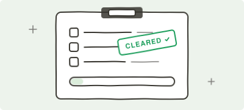</a> 
<b><a href="https://www.nodues-arcclub.tech/">NoDues</a></b> &nbsp;  
Semester clearance for ~2,100 students and 30+ faculty at MITS. Approvals update live over SSE, and class setup imports Excel timetables with fuzzy faculty matching. 
<code>React</code> <code>Express</code> <code>MongoDB</code> &nbsp;·&nbsp; <a href="https://github.com/Usman0226/NoDues">Source</a>
</td>
<td width="50%" valign="top">
<a href="https://dfesta.in">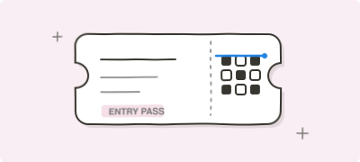</a> 
<b><a href="https://dfesta.in">D'FESTA 2K26</a></b> &nbsp;  
Ticketing, payments and judging for the department symposium. AES-signed QR tickets, triple-node SMTP failover, and paise-offset UPI reconciliation. 
<code>Next.js 16</code> <code>TypeScript</code> <code>MongoDB</code>
</td>
</tr>
<tr>
<td valign="top">
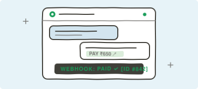 
<b>BizEasy</b> 
A seller platform for small businesses in Andhra Pradesh, run over  WhatsApp. I'm the backend engineer. Each seller connects their own number to their own bot. 
<code>Node.js</code> <code>Meta Cloud API</code> <code>Razorpay</code>
</td>
<td valign="top">
<a href="https://ncc-exam-portal.vercel.app/">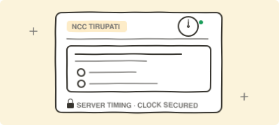</a> 
<b><a href="https://ncc-exam-portal.vercel.app/">NCC Exam Portal</a></b> &nbsp;  
Timed exams for the NCC Tirupati Unit with admin, officer and cadet  roles. Tenant isolation lives in Prisma middleware, and the server decides when an exam  ends. 
<code>React</code> <code>Express</code> <code>PostgreSQL</code> <code>Prisma</code>
</td>
</tr>
<tr>
<td valign="top">
<a href="https://github.com/Usman0226/The-Brain">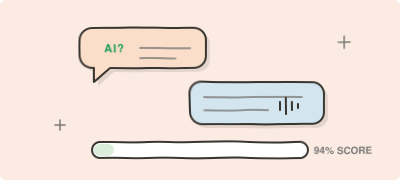</a> 
<b><a href="https://github.com/Usman0226/The-Brain">HireMinds AI</a></b> &nbsp;  
An autonomous interviewer with an agentic loop, a multi-layer evaluation engine, a critic layer and a recruiter dashboard. 
<code>FastAPI</code> <code>React</code> <code>Groq</code>
</td>
<td valign="top">
<a href="https://github.com/Usman0226/LifeLink">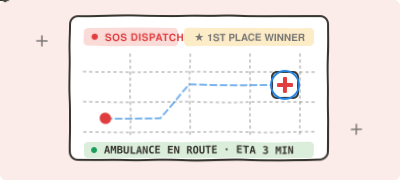</a> 
<b><a href="https://github.com/Usman0226/LifeLink">LifeLink</a></b> &nbsp;  
 Emergency medical dispatch platform connecting hospitals, ambulances, and patients with real-time geolocation. LifeLink Hackathon Winner. 
<code>React</code> <code>Node.js</code> <code>Socket.io</code> <code>Leaflet</code>
</td>
</tr>
</table>

<b>How a BizEasy order flows</b>

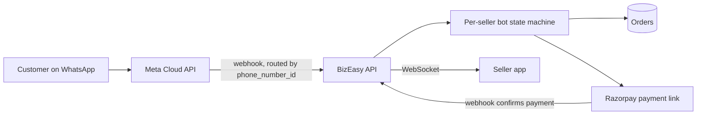

More on GitHub

- [OCR_BENCHMARKING](https://github.com/Usman0226/OCR_BENCHMARKING): benchmarking OCR engines (PaddleOCR, Tesseract) on scanned historical documents, with word-level bounding boxes.
- [COMPONENTS](https://github.com/Usman0226/COMPONENTS): motion components for React. Copy, paste, done.
- [Agent-Effi](https://github.com/Usman0226/Agent-Effi): makes your AI agent think like the laziest senior dev in the room.
- [INCOIS-Sytem](https://github.com/Usman0226/INCOIS-Sytem): oceanographic scientist dashboard with geospatial ocean data visualization.

## Live systems


## Recognition


## Stack

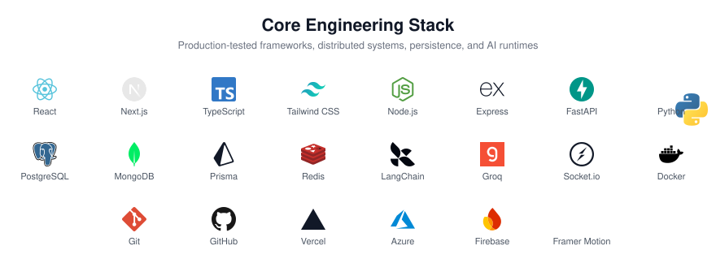

## Activity


Client and event platforms live in private repositories, so this shows only part of the work. Redrawn every day by a GitHub Action.

## Contact

Available for freelance contracts, full-stack MVPs, and client projects:

